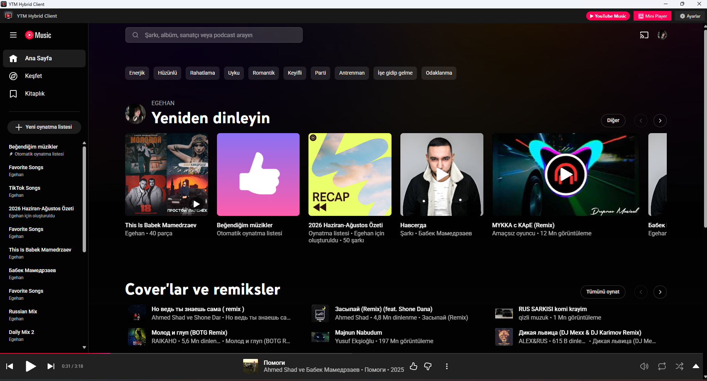
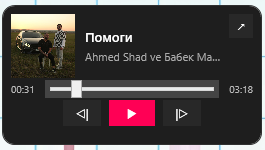
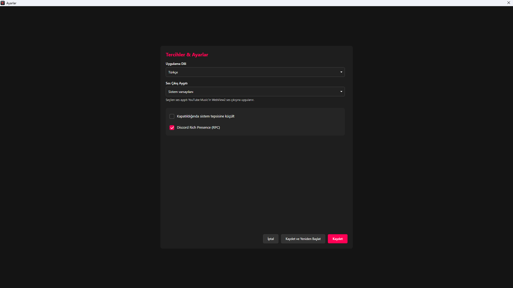
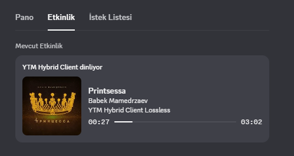

# YTM Hybrid Client

<p align="center">
  
</p>

<h1 align="center">YTM Hybrid Client</h1>

<p align="center">
  <strong>A Modern YouTube Music Desktop Experience for Windows</strong>
</p>

<p align="center">
  
  
  
  <a href="LICENSE">
    
  </a>
</p>

**YTM Hybrid Client** is an open-source Windows desktop application that brings YouTube Music into a clean, modern desktop environment.

Built with C#, WPF, and .NET 9, it provides an embedded YouTube Music experience powered by Microsoft WebView2, selectable Windows audio output devices, Discord Rich Presence, automatic updates, and convenient desktop integration.

## Overview

YTM Hybrid Client transforms the YouTube Music web experience into a dedicated Windows desktop application with a dark-themed WPF interface.

The application uses Microsoft WebView2 to display and run YouTube Music, while NAudio provides audio output device selection and routing.

With additional features such as Discord Rich Presence, GitHub Auto-Updater, Mini Player, and System Tray integration, YTM Hybrid Client offers a convenient desktop listening experience.

## Key Features

### YouTube Music Desktop Experience

- Clean, dark-themed Windows desktop interface.
- Embedded YouTube Music experience powered by Microsoft WebView2.
- Access to your YouTube Music account and personal library.
- Dedicated desktop application experience built with WPF.
- Active playback status indicator in the top bar.

### Audio Output Device Selection

- Select your preferred Windows audio playback device directly from Settings.
- Audio device management powered by NAudio.
- Route application audio to your selected Windows output device.
- Change your preferred output device through the application's Settings interface.

### Discord Rich Presence

**Introduced in v1.6.0.**

- Displays your current listening activity on Discord.
- Shows the status *Listening to YTM Hybrid Client*.
- Displays the current track title and artist name.
- Shows album artwork.
- Includes a real-time playback progress bar.
- Can be enabled or disabled through Settings.

### GitHub Auto-Updater

**Introduced in v1.6.0.**

- Automatically checks GitHub Releases when the application starts.
- Detects when a newer version is available.
- Displays an update button in the top bar.
- Provides a one-click way to start the update process.

### Mini Player & System Tray

- Compact floating Mini Player mode.
- Open Mini Player directly from the top bar or system tray.
- Optional minimize-to-tray behavior.
- Quick media and application controls from the system tray:
  - Play / Pause
  - Next Track
  - Open Settings
  - Open Mini Player
  - Exit Application

### Bilingual Interface

- English (`English`)
- Turkish (`Türkçe`)
- Switch the application interface language through Settings.

## Screenshots

### Main Window


### Mini Player


### Settings


### Discord Rich Presence

-->

## Installation

### Windows Installer

YTM Hybrid Client is distributed as a Windows installer built with **Inno Setup**.

1. Visit the [GitHub Releases](https://github.com/egehansimarikk/YtmHybridClient-Charp/releases) page.
2. Download `YTM_Hybrid_Client_v1.6.0_Setup.exe`.
3. Run the installer and follow the installation instructions.
4. Launch YTM Hybrid Client.
5. Sign in to your YouTube Music account through the embedded browser.

### Requirements

- Windows 10 or Windows 11 (64-bit).
- .NET 9 Desktop Runtime.
- Microsoft Edge WebView2 Runtime.

WebView2 Runtime is already available on most up-to-date Windows installations. Install it separately if it is missing.

## Building from Source

### Prerequisites

- Windows 10 or Windows 11.
- .NET 9 SDK.
- Visual Studio 2022 (17.12 or later).
- Visual Studio **.NET desktop development** workload.
- Git.

### Using the .NET CLI

Clone the repository:

```bash
git clone https://github.com/egehansimarikk/YtmHybridClient-Charp.git
```

Navigate to the project directory:

```bash
cd YtmHybridClient-Charp
```

Restore dependencies:

```bash
dotnet restore
```

Build the application:

```bash
dotnet build -c Release
```

### Using Visual Studio

1. Clone or download the repository.
2. Open the solution file in Visual Studio 2022.
3. Make sure the .NET 9 SDK and .NET desktop development workload are installed.
4. Select the **Release** configuration.
5. Build the solution.

The project targets:

```xml
net9.0-windows10.0.17763.0
```

## Tech Stack

| Technology          | Purpose                                           |
| ------------------- | ------------------------------------------------- |
| C#                  | Main programming language                         |
| WPF                 | Windows desktop user interface                    |
| .NET 9              | Application framework                             |
| Microsoft WebView2  | Embedded YouTube Music integration                |
| NAudio              | Windows audio output device selection and routing |
| DiscordRichPresence | Discord Rich Presence integration                 |
| GitHub Releases     | Application update distribution                   |
| Inno Setup          | Windows installer packaging                       |

## License

This project is licensed under the **MIT License**.

See the [LICENSE](LICENSE) file for the complete license text.

## Disclaimer

- YTM Hybrid Client is an unofficial third-party application and is not affiliated with, endorsed by, or sponsored by Google or YouTube.
- YouTube Music functionality depends on the availability and behavior of the YouTube Music website.
- Discord Rich Presence requires Discord to be running and available.
- Users are responsible for complying with the terms and conditions of the services they use.

---

# YTM Hybrid Client

<p align="center">
  <strong>Windows İçin Modern Bir YouTube Music Masaüstü Deneyimi</strong>
</p>

<p align="center">
  
  
  
  <a href="LICENSE">
    
  </a>
</p>

**YTM Hybrid Client**, YouTube Music'i modern ve sade bir Windows masaüstü ortamına taşıyan açık kaynaklı bir masaüstü uygulamasıdır.

C#, WPF ve .NET 9 kullanılarak geliştirilen uygulama; Microsoft WebView2 ile entegre edilmiş YouTube Music deneyimi, Windows ses çıkış cihazı seçimi, Discord Rich Presence, otomatik güncelleme ve masaüstü entegrasyonu gibi özellikler sunar.

## Genel Bakış

YTM Hybrid Client, YouTube Music web deneyimini koyu temalı bir WPF arayüzüyle bağımsız bir Windows masaüstü uygulamasına dönüştürür.

Uygulama, YouTube Music'i görüntülemek ve çalıştırmak için Microsoft WebView2 kullanırken NAudio aracılığıyla Windows ses çıkış cihazlarının seçilmesini ve ses yönlendirmesini sağlar.

Discord Rich Presence, GitHub Auto-Updater, Mini Player ve Sistem Tepsisi entegrasyonu gibi özelliklerle kullanışlı bir masaüstü müzik deneyimi sunar.

## Temel Özellikler

### YouTube Music Masaüstü Deneyimi

- Sade ve koyu temalı Windows masaüstü arayüzü.
- Microsoft WebView2 ile entegre edilmiş YouTube Music deneyimi.
- YouTube Music hesabına ve kişisel müzik kitaplığına erişim.
- WPF ile geliştirilmiş bağımsız masaüstü uygulaması.
- Üst araç çubuğunda aktif oynatma durumunu gösteren durum göstergesi.

### Ses Çıkış Cihazı Seçimi

- Tercih edilen Windows ses çıkış cihazını doğrudan Ayarlar üzerinden seçebilme.
- NAudio destekli ses cihazı yönetimi.
- Uygulama sesini seçilen Windows ses çıkış cihazına yönlendirme.
- Tercih edilen ses çıkış cihazını uygulamanın Ayarlar arayüzünden değiştirebilme.

### Discord Rich Presence

**v1.6.0 ile eklendi.**

- Discord üzerinde mevcut dinleme etkinliğini gösterir.
- *Listening to YTM Hybrid Client* durumunu görüntüler.
- Çalan parçanın adını ve sanatçı bilgisini gösterir.
- Albüm kapağını görüntüler.
- Gerçek zamanlı oynatma ilerleme çubuğu sunar.
- Ayarlar üzerinden etkinleştirilebilir veya devre dışı bırakılabilir.

### GitHub Otomatik Güncelleyici

**v1.6.0 ile eklendi.**

- Uygulama açıldığında GitHub Releases üzerinden yeni sürümleri otomatik olarak kontrol eder.
- Yeni bir sürüm mevcut olduğunda algılar.
- Üst araç çubuğunda güncelleme butonu gösterir.
- Tek tıklamayla güncelleme sürecini başlatmayı sağlar.

### Mini Player ve Sistem Tepsisi

- Kompakt ve kayan Mini Player modu.
- Üst araç çubuğundan veya sistem tepsisinden Mini Player'ı açabilme.
- İsteğe bağlı olarak uygulamayı sistem tepsisine küçültme.
- Sistem tepsisinden hızlı medya ve uygulama kontrolleri:
  - Oynat / Duraklat
  - Sonraki Parça
  - Ayarları Aç
  - Mini Player'ı Aç
  - Uygulamadan Çık

### İki Dilli Arayüz

- İngilizce (`English`)
- Türkçe (`Türkçe`)
- Uygulama dili Ayarlar üzerinden değiştirilebilir.

## Ekran Görüntüleri

### Ana Pencere


### Mini Player


### Ayarlar


### Discord Rich Presence


-->

## Kurulum

### Windows Kurulum Dosyası

YTM Hybrid Client, **Inno Setup** kullanılarak oluşturulmuş bir Windows kurulum dosyası üzerinden dağıtılır.

1. [GitHub Releases](https://github.com/egehansimarikk/YtmHybridClient-Charp/releases) sayfasını açın.
2. `YTM_Hybrid_Client_v1.6.0_Setup.exe` dosyasını indirin.
3. Kurulum dosyasını çalıştırın ve kurulum adımlarını takip edin.
4. YTM Hybrid Client uygulamasını başlatın.
5. Uygulama içerisindeki tarayıcı üzerinden YouTube Music hesabınıza giriş yapın.

### Gereksinimler

- Windows 10 veya Windows 11 (64-bit).
- .NET 9 Desktop Runtime.
- Microsoft Edge WebView2 Runtime.

WebView2 Runtime, güncel Windows kurulumlarının çoğunda zaten bulunmaktadır. Sistemde bulunmuyorsa ayrıca yüklenmesi gerekir.

## Kaynak Koddan Derleme

### Gereksinimler

- Windows 10 veya Windows 11.
- .NET 9 SDK.
- Visual Studio 2022 (17.12 veya üzeri).
- Visual Studio **.NET masaüstü geliştirme** iş yükü.
- Git.

### .NET CLI ile

Depoyu klonlayın:

```bash
git clone https://github.com/egehansimarikk/YtmHybridClient-Charp.git
```

Proje klasörüne girin:

```bash
cd YtmHybridClient-Charp
```

Bağımlılıkları geri yükleyin:

```bash
dotnet restore
```

Uygulamayı derleyin:

```bash
dotnet build -c Release
```

### Visual Studio ile

1. Depoyu klonlayın veya indirin.
2. Çözüm dosyasını Visual Studio 2022 ile açın.
3. .NET 9 SDK ve .NET masaüstü geliştirme iş yükünün yüklü olduğundan emin olun.
4. **Release** yapılandırmasını seçin.
5. Çözümü derleyin.

Projenin hedef framework değeri:

```xml
net9.0-windows10.0.17763.0
```

## Teknoloji Yığını

| Teknoloji           | Kullanım Amacı                                 |
| ------------------- | ---------------------------------------------- |
| C#                  | Ana programlama dili                           |
| WPF                 | Windows masaüstü arayüzü                       |
| .NET 9              | Uygulama framework'ü                           |
| Microsoft WebView2  | YouTube Music entegrasyonu                     |
| NAudio              | Windows ses çıkış cihazı seçimi ve yönlendirme |
| DiscordRichPresence | Discord Rich Presence entegrasyonu             |
| GitHub Releases     | Uygulama güncelleme dağıtımı                   |
| Inno Setup          | Windows kurulum paketi oluşturma               |

## Lisans

Bu proje **MIT Lisansı** altında yayımlanmaktadır.

Lisansın tam metni için [LICENSE](LICENSE) dosyasına göz atabilirsiniz.

## Sorumluluk Reddi

- YTM Hybrid Client, Google veya YouTube ile bağlantısı, sponsorluğu veya resmî onayı bulunmayan bağımsız bir üçüncü taraf uygulamasıdır.
- YouTube Music özellikleri, YouTube Music web sitesinin erişilebilirliğine ve çalışma biçimine bağlıdır.
- Discord Rich Presence özelliğinin çalışması için Discord uygulamasının çalışır durumda olması gerekir.
- Kullanıcılar, kullandıkları hizmetlerin hüküm ve koşullarına uymaktan sorumludur.